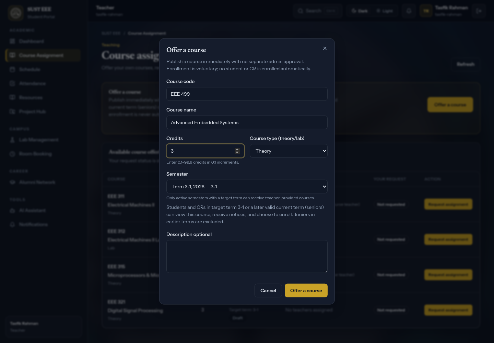
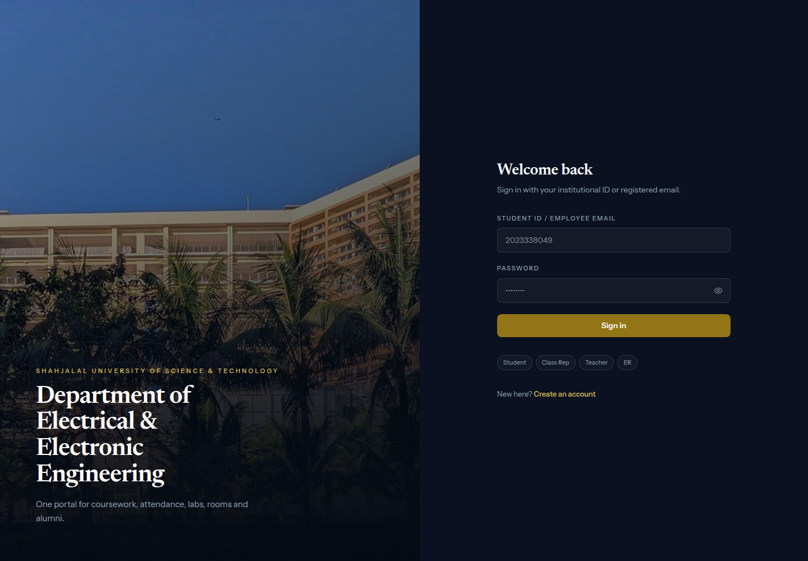
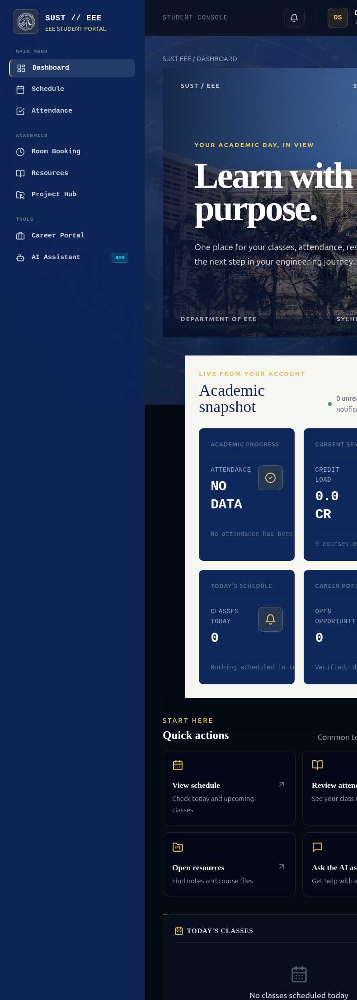
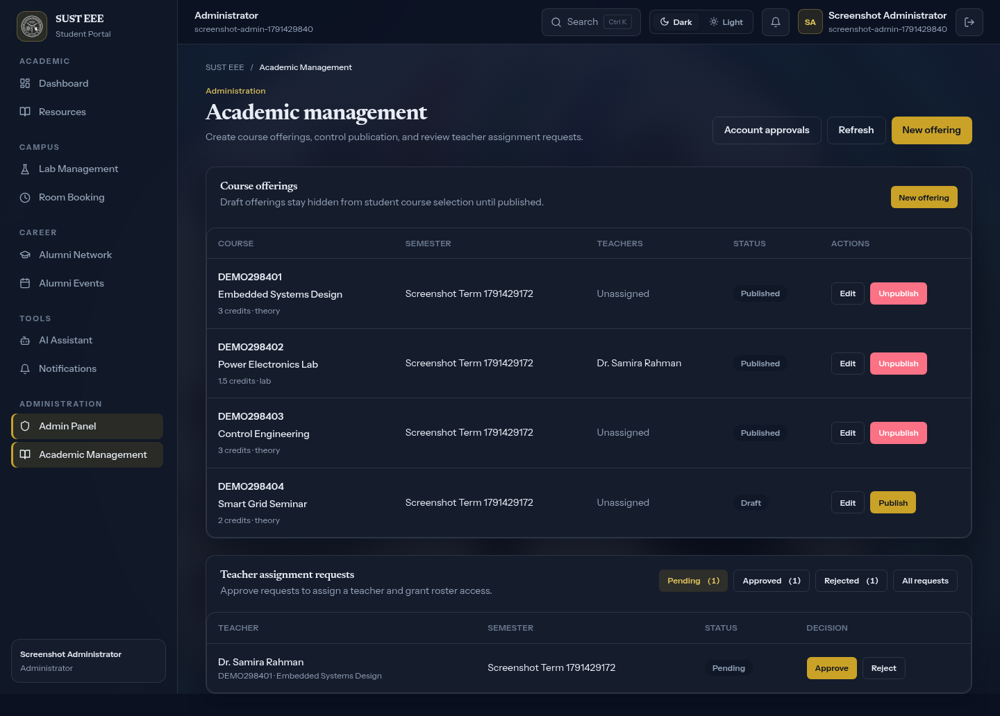
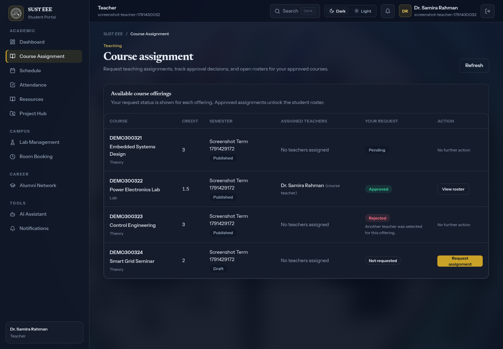

# SUST EEE Smart Student Portal

[](https://github.com/kakonRoy150636/Student-Portal-of-EEE-SUST/actions/workflows/ci.yml)
[](docker-compose.yml)
[](backend)
[](frontend)
[](database)
[](LICENSE)

A role-aware academic portal for the Department of Electrical and Electronic
Engineering at Shahjalal University of Science and Technology. It connects
course planning, enrollment, attendance, schedules, bookings, resources,
projects, career services, notifications, AI search, and alumni workflows in one
auditable application.

## Product preview

The following feature image was captured from the running local application. A
teacher can open **Offer a course** from the dashboard, publish immediately for
an active target term, and become the assigned teacher without separate admin
approval. Enrollment remains voluntary: same-term students/CRs and seniors can
see the course and choose to enroll; juniors cannot.



| Login | Student dashboard |
|---|---|
|  |  |

| Admin academic management | Teacher assignments |
|---|---|
|  |  |

## Features

| Area | Included workflows |
|---|---|
| Academic operations | Course catalogue and offerings, teacher approvals, teacher-provided courses, term-based course selection, select/drop/reselect, credit limits, schedules, attendance, dashboards, and per-offering Course Workspace |
| Access control | JWT authentication, rotated refresh tokens, HttpOnly refresh cookies, active-account checks, and backend-enforced RBAC |
| Booking and resources | Room/lab conflict prevention, equipment workflows, course-scoped resources, presigned MinIO/S3 uploads, ownership checks, and full-text resource search |
| Projects and career | Capstone supervision, GitHub integration, opportunities, JSON Resume profiles, and public portfolios |
| Notifications and PWA | Course announcements, event reminders, durable inbox, SSE updates, Firebase Cloud Messaging, preferences, quiet hours, offline routine support, and installable PWA behavior |
| AI assistant | Cited Gemini answers, PostgreSQL/pgvector retrieval, safe abstention, and Redis quota/cost controls |
| Alumni portal | Batch-aware profiles, privacy-safe directory, career timelines, CSV import, verification, events, mentorship, scholarships, news, and gallery foundations |

### Academic term policy

Teacher-provided courses use the explicit order
`1-1 < 1-2 < 2-1 < 2-2 < 3-1 < 3-2 < 4-1 < 4-2`. For a `3-1` offering,
`3-1`, `3-2`, `4-1`, and `4-2` students/CRs qualify. Earlier, invalid, or
missing profile terms fail closed for scoped offerings. A legacy semester with
`NULL target_term` remains unrestricted. Notifications never enroll a student
automatically. See the [repeatable workflow check](docs/SEMESTER_WORKFLOW_VERIFICATION.md)
and [notification contract](docs/NOTIFICATIONS.md). Course Workspace details,
announcement lifecycle, resource rules, events, and questions are in
[COURSE_WORKSPACE.md](docs/COURSE_WORKSPACE.md).

## Roles

| Role | Main access |
|---|---|
| Student | Enrollment, schedules, attendance, bookings, resources, projects, career, and AI assistant |
| Class Representative | Student workflows plus class coordination and CR tools |
| Teacher | Course offerings, assignment approvals, attendance, lab workflows, and project supervision |
| Lab Assistant / ER | Lab inventory, equipment checkout, damage reports, and assigned lab workflows |
| Alumni | Verified profile, directory, events, mentorship, scholarships, and alumni dashboard |
| Super Admin | User approval, department configuration, analytics, and administrative controls |

Detailed route and permission rules are documented in
[ROLE_ARCHITECTURE.md](docs/ROLE_ARCHITECTURE.md).

## Architecture and stack

```text
React 18 + TypeScript + Vite
              │
              ▼
FastAPI + async SQLAlchemy + JWT/RBAC
              │
      ┌───────┼────────┬──────────────┐
      ▼       ▼        ▼              ▼
 PostgreSQL  Redis/   MinIO/S3       FCM /
 pgvector   Celery   storage         Gemini
```

| Layer | Tools |
|---|---|
| Frontend | React, TypeScript, Vite, React Router, Tailwind CSS, TanStack Query, Lucide |
| Backend | FastAPI, Python 3.11, SQLAlchemy 2 async, Pydantic v2, Alembic |
| Data and jobs | PostgreSQL 16, pgvector, GiST constraints, full-text search, Redis, Celery |
| Storage and integrations | MinIO/AWS S3, Firebase FCM, Google Gemini, GitHub webhooks |
| Delivery | Docker Compose, Nginx, PWA service worker |

## Quick start

### Prerequisites

- Docker Engine with Docker Compose v2
- Git

### Configure and run

```bash
git clone https://github.com/kakonRoy150636/Student-Portal-of-EEE-SUST.git
cd Student-Portal-of-EEE-SUST
cp .env.example .env
docker compose up --build -d
```

Change `SECRET_KEY` before using any non-local environment. Gemini and Firebase
credentials are optional for the core portal and required only for their
integrations. The Compose stack applies pending Alembic migrations before the
API and workers start.

Open the local services:

| Service | URL |
|---|---|
| Frontend | <http://localhost:5173> |
| Backend health | <http://localhost:8000/health> |
| API docs | <http://localhost:8000/api/docs> |
| OpenAPI schema | <http://localhost:8000/openapi.json> |
| MinIO console | <http://localhost:9001> |

PostgreSQL and Redis are also exposed locally on ports `5433` and `6380` by the
development Compose file. The MinIO API is on `9000`.

### Optional development seed

```bash
docker compose --profile dev-seed run --rm seed-dev
```

The seed is guarded for `ENVIRONMENT=development` and is intended only for a
disposable development database. It is not included in the production Compose
file. See [SEMESTER_WORKFLOW_VERIFICATION.md](docs/SEMESTER_WORKFLOW_VERIFICATION.md)
for the seeded teacher/course workflow and live browser verification.

### Migrations

Alembic owns schema upgrades. Run the one-shot migration service explicitly when
deploying an existing environment:

```bash
docker compose run --rm migrate
```

Create future changes as new revisions; keep ORM models and the reference
`database/schema.sql` aligned, or document an intentional additive Alembic-only
table such as the Course Workspace tables. For production, use
`docker-compose.prod.yml` and never run the development seed.

## Testing and quality

Backend checks use a separate PostgreSQL/Redis Compose project with temporary
data and no published ports:

```bash
docker compose -p portal-critical-tests -f docker-compose.test.yml \
  up --build --abort-on-container-exit --exit-code-from tests
docker compose -p portal-critical-tests -f docker-compose.test.yml down -v
```

Frontend checks from the repository root:

```bash
npm --prefix frontend run lint
npm --prefix frontend run typecheck
npm --prefix frontend run test
npm --prefix frontend run build
```

The CI workflow also runs Ruff, mypy, pip/npm audits, Docker builds, and Trivy
scans. Detailed results, known expected failures, and security boundaries are in
[CI_VERIFICATION.md](docs/CI_VERIFICATION.md),
[BACKEND_TEST_REPORT.md](docs/BACKEND_TEST_REPORT.md), and
[SECURITY_AUDIT.md](docs/SECURITY_AUDIT.md).

For the real teacher/student term workflow, use the disposable-stack guide in
[SEMESTER_WORKFLOW_VERIFICATION.md](docs/SEMESTER_WORKFLOW_VERIFICATION.md).

## Repository layout

```text
backend/
  app/                  FastAPI application, models, services, and tasks
  alembic/              Alembic revisions and SQL baseline
  tests/                Unit and PostgreSQL integration tests
  pyproject.toml        Python dependencies and tooling
frontend/
  src/                  React/TypeScript application
  e2e/                  Playwright workflows
  package.json          Frontend scripts and dependencies
database/
  schema.sql            Reference schema
  dev/                  Development-only seed and guard
  migrations/           Historical SQL migrations
docs/
  screenshots/          Product screenshots
  *.md                  Feature, operations, security, and verification guides
docker-compose.yml
docker-compose.prod.yml
.github/workflows/ci.yml
.env.example
LICENSE
```

## Documentation

- [Alumni portal](docs/ALUMNI.md)
- [AI assistant](docs/AI_ASSISTANT.md)
- [Course Workspace](docs/COURSE_WORKSPACE.md)
- [Notifications and FCM](docs/NOTIFICATIONS.md)
- [PWA setup](docs/PWA.md)
- [Role architecture](docs/ROLE_ARCHITECTURE.md)
- [Semester workflow verification](docs/SEMESTER_WORKFLOW_VERIFICATION.md)
- [Security audit](docs/SECURITY_AUDIT.md)

## Contributing

1. Create a feature branch.
2. Keep migrations, ORM models, and reference SQL aligned.
3. Run focused backend tests plus frontend lint, typecheck, and build.
4. Open a pull request describing the change and validation performed.

## License

Distributed under the MIT License. See [LICENSE](LICENSE).

## Author

**Kakon Roy** — EEE, SUST · [GitHub](https://github.com/kakonRoy150636)
